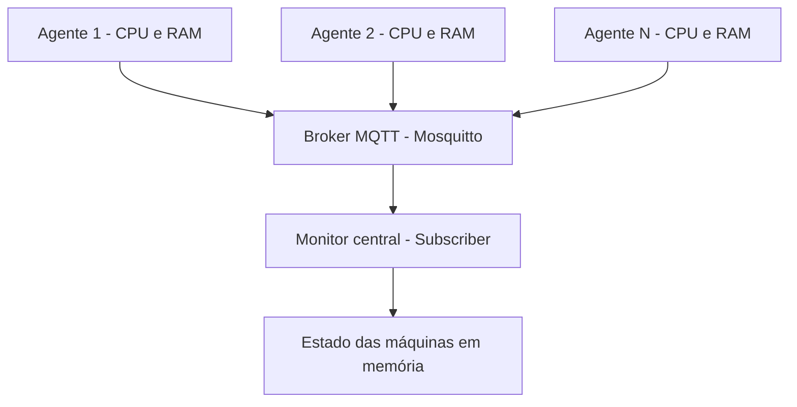

# Arquitetura do Sistema — Equipe 06

## Objetivo

Desenvolver um sistema distribuído de monitoramento de desempenho que utiliza MQTT para transmitir métricas de CPU e memória RAM de diferentes computadores para um monitor central.

## Arquitetura adotada

O sistema utiliza o modelo Publisher/Subscriber, composto por três elementos:

1. **Agente (Publisher):** coleta periodicamente as métricas da máquina com a biblioteca psutil e publica mensagens MQTT.
2. **Broker (Mosquitto):** recebe as publicações dos agentes e as distribui aos assinantes interessados.
3. **Monitor central (Subscriber):** recebe as métricas usando wildcards, armazena o último estado conhecido por máquina e exibe as informações.

## Diagrama da arquitetura

## Hierarquia de tópicos

- `monitoramento/<id_maquina>/cpu`
- `monitoramento/<id_maquina>/memoria`

Exemplos:

- `monitoramento/maquina01/cpu`
- `monitoramento/maquina01/memoria`
- `monitoramento/maquina02/cpu`
- `monitoramento/maquina02/memoria`

## Wildcards

- `monitoramento/+/cpu`: CPU de todas as máquinas.
- `monitoramento/+/memoria`: memória de todas as máquinas.
- `monitoramento/+/+`: as duas métricas de todas as máquinas.
- `monitoramento/#`: todos os tópicos abaixo de monitoramento.

## Qualidade de serviço

Será utilizado QoS 0 nas publicações periódicas.

Essa escolha reduz o custo de comunicação e é adequada ao cenário de monitoramento contínuo, no qual novas leituras são publicadas regularmente.

A entrega de cada mensagem não é garantida.

## Métricas monitoradas

1. CPU: uso geral e por núcleo lógico.
2. Memória RAM: total, utilizada e livre.

Intervalo inicial de coleta: 5 segundos, configurável.

## Estrutura de estado prevista

O monitor central manterá uma estrutura em memória organizada pelo identificador de cada máquina.

Para cada máquina, serão armazenadas as últimas métricas de CPU e memória, além do horário da última atualização.

## Formato das mensagens

As mensagens serão transmitidas em JSON.

A definição detalhada dos campos, das unidades, dos timestamps e das regras de validação será documentada em `docs/protocol.md`.

## Segurança e ambiente

O broker de desenvolvimento será executado inicialmente em `127.0.0.1:1883`, com acesso local.

Autenticação e comunicação segura deverão ser configuradas antes de disponibilizar o broker em rede externa.